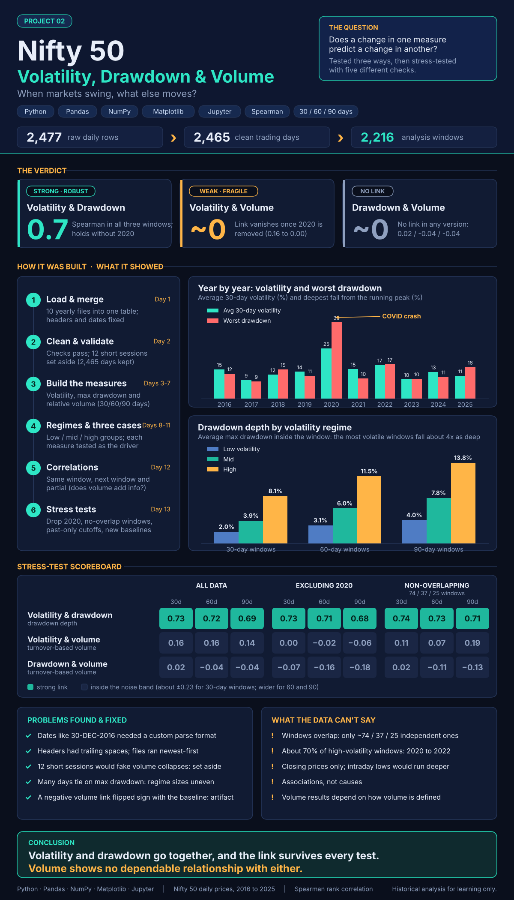
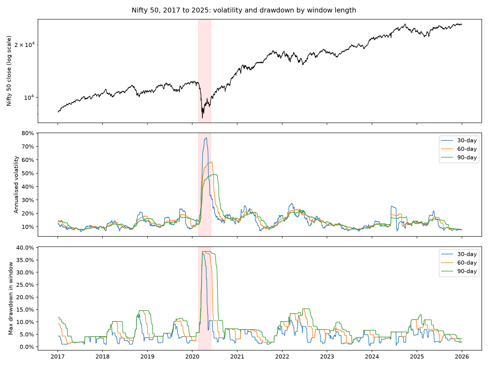
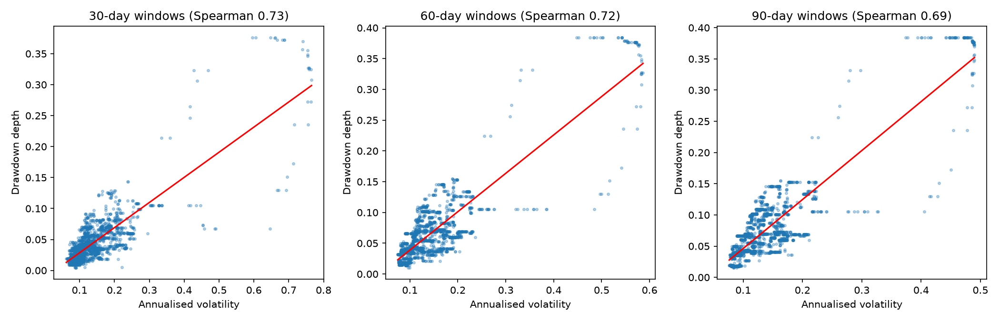
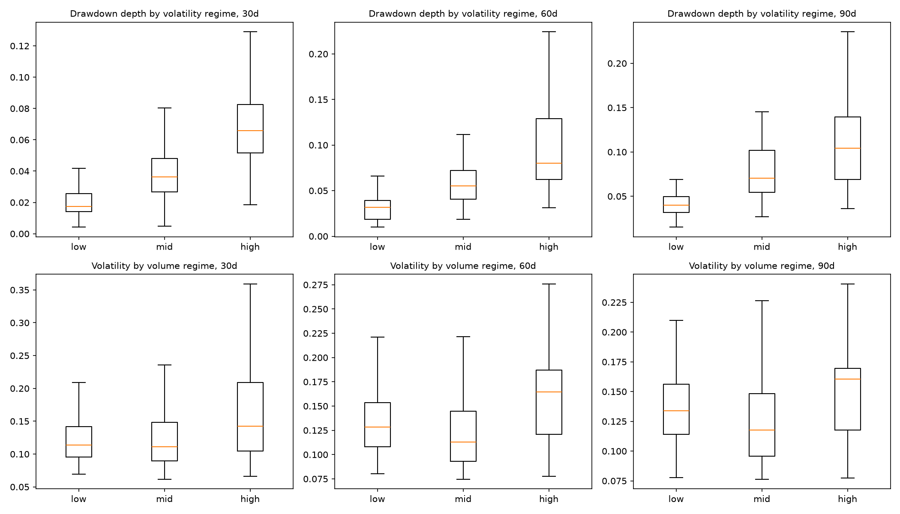
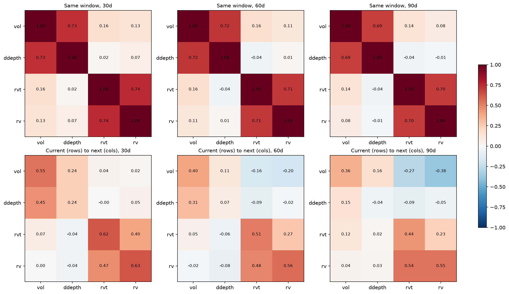
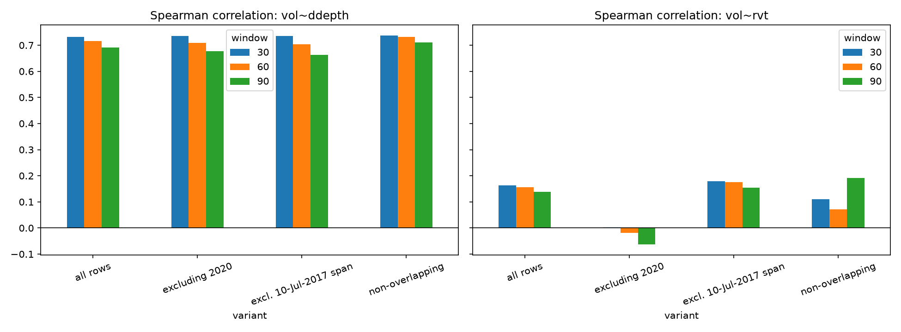

# Nifty 50: Volatility, Drawdown and Volume Relationships

In my first Nifty 50 project I looked at the index as a whole. This time I wanted to ask a narrower question: when the market gets more volatile, does it also fall further and trade more, and does any of that help predict what comes next? I used ten years of daily data and looked at it through 30, 60 and 90 trading day windows.



## What I found



**1. Volatility and drawdown go together, and this held up in every check.**
Windows with higher volatility also had deeper drawdowns. The Spearman correlation was 0.73 for 30-day windows, 0.72 for 60-day and 0.69 for 90-day. The gap is large when you split windows into low and high volatility:

| Window | Average drawdown, low volatility | Average drawdown, high volatility |
|---|---|---|
| 30 days | 2.0% | 8.1% |
| 60 days | 3.1% | 11.5% |
| 90 days | 4.0% | 13.8% |

Almost none of the calmest windows fell into the deepest drawdown group.





**2. Volume is a weak signal, and most of it came from 2020.**
Volatility and trading volume only had a correlation of about 0.14 to 0.16. High-volatility windows traded slightly more than usual (turnover about 1.12 times normal, against 1.04 for calm windows), but when I removed 2020 the link dropped to roughly zero. Drawdown depth and volume had no link at all, with correlations between -0.04 and 0.02.

**3. Volume did not help predict the next window.**
Volatility is fairly persistent: a 30-day window's volatility has a correlation of 0.55 with the next 30 days (0.40 for 60 days and 0.36 for 90 days). Once I accounted for the current level, volume added almost nothing, with partial correlations between -0.08 and 0.09.

**4. One result I don't trust.**
For the longer windows, high volatility was followed by lower volume. But that result changed a lot depending on how I defined "normal" volume (a 120, 250 or 500 day baseline), so I wouldn't lean on it.



## How I measured things

- **Volatility:** standard deviation of daily log returns over the window, multiplied by the square root of 252 to annualise it.
- **Drawdown depth:** the largest fall from a peak inside the window, shown as a positive number.
- **Volume:** the window's average turnover divided by the average over the previous 250 trading days. I used traded shares as a cross-check.
- **Regimes:** within each window length, the bottom 25% of values are "low", the top 25% are "high" and the rest are "mid".
- **Correlation:** Spearman, because the data has a few extreme values and I didn't want them to dominate.

## Data and cleaning

The data is NSE daily Nifty 50 values from 2016 to 2025, 2,477 rows in total.

- I removed 12 short sessions (10 Diwali Muhurat sessions and 2 special Saturday sessions used for disaster-recovery tests), because their volume would look like a false collapse. The two Budget day Saturdays were full sessions, so they stayed in.
- 10 July 2017 has an unusually low volume. I kept it, flagged it, and tested the results with it removed.
- The 250-day volume baseline needs a year of history, so the analysis itself runs from 5 January 2017 to 31 December 2025 (2,216 rows).

## How I checked it

- Recalculated one value by hand for each of volatility, drawdown and volume.
- Checked that longer windows never show a smaller maximum drawdown than shorter ones inside them.
- Reran the correlations without 2020, without the 10 July 2017 stretch, and using only non-overlapping windows.
- Rebuilt the regimes using only information available at the time, to make sure I wasn't using the future to label the past. The high-versus-low drawdown gap stayed in the same direction (5.5, 6.9 and 7.8 percentage points).



## Limits

- It is one index over one decade, and the 2020 crash dominates the extreme end of the data.
- Neighbouring windows overlap, so they aren't independent and the correlations look more certain than they really are. The non-overlapping check helps, but it leaves only 25 to 74 points.
- This describes relationships. It doesn't show cause and effect, and it isn't a trading strategy.

## Repo layout

```
notebook/       the full analysis in one Jupyter notebook
data/raw/       yearly NSE Nifty 50 files, 2016 to 2025
figures/        charts used in this README
Summary_Image/  project overview graphic
```

## Running it yourself

1. Install Python with pandas, NumPy and matplotlib.
2. Open the notebook from inside the `notebook/` folder, so that the data path (`../data/raw`) works.
3. Run it from top to bottom. It writes a few intermediate CSV files next to the notebook as it goes.

## Notes

- Tools: Python, pandas, NumPy, matplotlib, Jupyter.
- This is a learning project, not investment advice.
